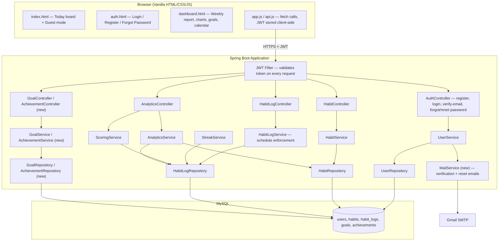
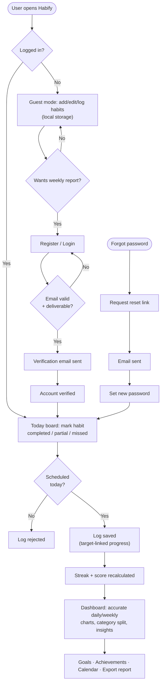

# Habify — Implementation Plan to 100% Completion

Based on the audit (70% complete) and a direct inspection of the codebase (Spring Boot + Java + JPA backend, H2/MySQL, vanilla HTML/CSS/JS frontend). This plan takes it from "working engine, broken edges" to a finished, submittable PBL project.

---

## 1. Decisions Locked In First

These decisions affect every phase below, so they're made once, up front, instead of being re-litigated module by module.

| Decision | Choice | Why |
|---|---|---|
| **Database** | Stay on **MySQL** (relational), drop the Mongo idea | The codebase already has JPA entities, foreign keys, a unique `(habit_id, date)` constraint, and repository interfaces built around a relational model. Moving to MongoDB means re-writing every entity, repository, and service — for zero functional gain, since none of your data (users → habits → logs) is document-shaped or schema-less. Relational is also the safer choice to defend in a viva, since you can show ER diagrams and explain normalization. |
| **Auth** | Real **JWT** authentication (Spring Security + `jjwt`) | Replaces the current `X-User-Id` / query-param fallback, which lets anyone impersonate any user. This is the single most important fix — it blocks a real security finding in your report. |
| **Frontend framework** | Keep **vanilla HTML/CSS/JS** | A framework rewrite (React/Vue) is not needed to hit 100% and would eat your remaining time on tooling instead of features. Vanilla JS is fine — the fix is the *design system* and *wiring*, not the framework. |
| **Charts** | Lightweight canvas-based charts (**Chart.js** via CDN) instead of the current hand-rolled `chart-box` divs | Accurate, proportional, animated bars/lines with almost no code, and it looks like a real product instead of a CSS hack. |
| **Email** | **Spring Boot Mail** + Gmail SMTP with an App Password | Same approach you've already used successfully with PHPMailer/Gmail SMTP on another project — same idea, just `JavaMailSender` instead of PHPMailer. |

---

## 2. Design System (no AI-slop, no neon, no gradients)

This is the spec every screen must follow. Treat it as a contract — if a component doesn't match this, it gets fixed before it's "done."

**Typography**
- Font stack: `-apple-system, BlinkMacSystemFont, "Segoe UI", Roboto, "Inter", Helvetica, Arial, sans-serif` — the same system-font stack real products (Linear, Notion, GitHub) use. No decorative/Google-Fonts display fonts.
- One weight scale: 400 (body), 500 (labels/buttons), 600 (headings). Avoid 700+/900 except a hero number (e.g. streak count).
- Base size 15–16px, line-height 1.5–1.6 for readability.

**Color — replace the current amber-gradient/glow theme entirely**
- Neutral base: a **slate/gray** scale for backgrounds, borders, text (e.g. `#0f172a` text, `#64748b` muted text, `#e2e8f0` borders, `#f8fafc` surface).
- **One** calm accent color, flat (no gradient) — e.g. a muted indigo or teal (`#4f46e5` or `#0d9488`). Used sparingly: primary buttons, active nav state, progress rings.
- Status colors, desaturated, not neon: success `#16a34a`, warning `#d97706`, danger `#dc2626` — used only for status (completed/partial/missed), never decoratively.
- **No `linear-gradient` on buttons/cards, no glow/box-shadow-as-neon.** Shadows should be a single soft `0 1px 3px rgba(0,0,0,0.08)` at most.
- Dark mode (optional stretch): same rules, inverted neutrals, same single accent.

**Iconography**
- Replace the emoji-as-icons pattern (📚💻🏋️🥗📖 in category filters) with a **single consistent icon set** (Lucide or Feather via SVG). Emoji-heavy UI is one of the biggest "AI slop" tells — a real product doesn't mix emoji and typography.

**Layout**
- 8px spacing scale (8/16/24/32/48).
- Cards: 1px border, 8–10px radius, no gradient fill, generous padding (20–24px).
- Empty states (no habits yet, no logs this week) get an actual designed state, not a blank div.

**Reference direction:** minimalist Notion-style habit-tracker boards, Streaks (iOS), and Loop Habit Tracker — flat cards, one accent color, clear typographic hierarchy, data-dense but calm.

### 2.1 Primary View: the Weekly Grid (from your sketch)

Your wireframe is a classic **habit-tracker matrix**, not a card board — that's the actual primary screen to build:

- **Columns** = tasks/habits (Java, Exercise, Yoga, Study, …).
- **Rows** = Monday → Sunday, one checkbox cell per (habit, day).
- **Top row** = "Complete Percentage (%)" — one number per habit column (e.g. Java 50%, Exercise 30%, Yoga 90%, Study 40%).
- **Bottom row** = "Weekly Completion Report (%)" — the aggregate, one number per column, and a headline number ("51%" in your sketch) for the overall week.
- **"Daily Report"** is the label for the grid as a whole, with the header naming each task.

This maps cleanly onto what already exists: `HabitLogService`'s range/history retrieval and the **7-day progress list** the audit confirmed already comes back from the dashboard-summary endpoint. So this is mostly a **frontend grid component**, not new backend work — build a table where each cell is a tri-state (completed / partial / missed / empty) checkbox styled per §2's status colors, header row pulls each habit's rolling completion %, footer row pulls the daily/weekly aggregate already returned by `AnalyticsService`.

In the finished design: flat cells with a thin border (no gradient fill), a filled/checked cell uses the single accent color or the status-green, an empty cell stays neutral-outline. This becomes the **default dashboard view**; the existing card-based "today board" (from `index.html`) can stay as the fast guest-mode entry point for logging a single habit, with the grid as the full weekly picture once logged in.

---

## 3. Module-by-Module Implementation Plan

### Module 1 — Core Habit & Tracking (75% → 100%)
- Enforce schedule rules server-side in `HabitLogService`: reject a log write if today's weekday isn't in the habit's selected-day schedule (currently unenforced).
- Wire `targetValue` into scoring: today it's stored metadata only, and completion % is manually typed in. Change logging so a numeric progress value (e.g. "1.3 of 2 hours") is captured and the completion % is *derived*, not entered.
- Surface the partial-progress modal from the main weekly tracker (it exists in code but has no entry point in the UI) — add a tap/click target on each day-cell that opens it.

### Module 2 — User/Auth/Profile (50% → 100%)
- Implement Spring Security + JWT: login issues a signed, expiring token; every protected endpoint validates it via a filter (replacing `AuthHelper`'s trust-the-header logic entirely).
- Add **email format + deliverability** checking (see §6) and **forgot-password** (see §6).
- Keep BCrypt (already correct) — no change needed there.

### Module 3 — Database/Persistence (70% → 100%)
- Switch the active profile to `mysql` for the real/demo run; keep H2 only for the test profile (`application-test.properties`), so tests stay fast but the demo shows real persistence.
- Move the hard-coded `root/root` MySQL credentials out of `application-mysql.properties` and into environment variables (`${DB_USER}`, `${DB_PASSWORD}`) with a `.env`/README instruction — hard-coded DB root credentials would be flagged instantly in a security review.
- Confirm `schema-mysql.sql` matches the JPA-generated schema (habit/user/log FKs, unique `(habit_id, log_date)`).

### Module 4 — Analytics/Scoring/Insights (65% → 100%)
- Fix the weekly/daily percentage math so it reads from the target-linked progress values (Module 1 change), not manually-entered percentages.
- Add **category distribution** (pie/donut or simple stacked bar: % of completions per category this week).
- Add 3–5 simple rule-based insights (e.g. "Your completion rate drops on weekends", "Coding habits have your longest streak") — plain conditional logic on existing data, no ML needed.
- Replace the hand-rolled `chart-box` bars with Chart.js line/bar charts driven by the real `DashboardSummaryResponse` data.

### Module 5 — Web Frontend/Dashboard (50% → 100%)
- Rebuild `dashboard.html`'s JS: implement `App.switchView`, `App.refreshDashboard`, `App.filterHabits` in `app.js` (currently called but never defined — this is why the dashboard is broken).
- Build the **Weekly Grid** (§2.1) as the dashboard's primary view: habit columns × day rows, with the completion-% header row and weekly-report footer row from the sketch.
- Reskin `index.html`, `auth.html`, `dashboard.html`, `style.css` against the §2 design system (drop the amber gradient/glow theme).
- Guest (local-storage) mode stays for quick capture, but the dashboard/weekly-report grid requires login (see §6.5) — gate it with a clear "Sign in to see your weekly report" state instead of failing silently.

### Module 6 — Goals/Achievements/Calendar/Reports (0% → 100%, built from scratch)
- **Goals**: simple entity (`Goal`: title, target habit(s), target date, status) + CRUD endpoints + a goals list UI.
- **Achievements**: rule-based badges computed from existing streak/log data (e.g. "7-day streak," "First habit completed," "30 logs total") — no new heavy backend needed, just a scoring pass over existing tables.
- **Calendar/history view**: a month-grid view reading from `HabitLogRepository` by date range — this is mostly a frontend view over data you already have.
- **Reports/export**: a "download my week/month as CSV or PDF" button — server-side generates from the same dashboard-summary data.

---

## 4. Structural / Build Order Plan

Work in this order — each phase is a prerequisite for the one after it, so building out of order causes rework.

```
Phase 0  Lock decisions (§1) — no code yet, just settle stack/DB/design choices
Phase 1  Security foundation: JWT auth, remove header/query-param trust
Phase 2  Core logic fixes: schedule enforcement, target-linked progress, partial-modal wiring
Phase 3  Fix dashboard.html: implement missing App.* functions, wire to real data
Phase 4  Accurate analytics: category distribution, insights, Chart.js graphs
Phase 5  Design system pass: reskin index/auth/dashboard to §2 spec, replace emoji icons
Phase 6  Email + forgot password: verification email, reset flow (needs Phase 1's auth in place)
Phase 7  Module 6 build: Goals → Achievements → Calendar → Reports (in that order — achievements depend on nothing new, calendar/reports are read-only views)
Phase 8  Testing: controller/API tests for auth + ownership, integration test for the full browser flow
Phase 9  Security audit (§7) — done LAST, against the finished system
```

**Why this order:**
- Auth (Phase 1) has to come before anything else, because once it's real, every other endpoint's ownership checks change — building features against the fake auth first means redoing them.
- Design (Phase 5) comes *after* functionality (Phases 2–4), not before — restyling a screen whose data flow is still broken means restyling it twice.
- Security audit (Phase 9) is last on purpose, per your own requirement (#9) — it should test the *finished* system, not a moving target.

---

## 5. Completion Checklist — "This is 100%" when every box is true

- [ ] Registering with a malformed or fake-looking email is rejected; a real login/reset flow proves the email is reachable.
- [ ] No endpoint trusts a client-supplied user ID — every protected request is authenticated via a validated JWT.
- [ ] A habit cannot be logged on a day it isn't scheduled for (server-enforced, not just UI-hidden).
- [ ] Completion % on the dashboard is computed from actual logged progress against each habit's target — not typed in.
- [ ] `dashboard.html` fully works: view switching, refresh, and category filtering all function (no console errors).
- [ ] Weekly and daily graphs are accurate against the underlying log data (spot-checkable by hand for one habit).
- [ ] Category distribution and at least 3 rule-based insights are visible on the dashboard.
- [ ] Goals, Achievements, Calendar view, and Report export all exist and work end-to-end.
- [ ] Forgot-password flow works: request → email → reset link → new password → login with new password.
- [ ] MySQL is the active profile for the demo; data survives an app restart.
- [ ] No hard-coded DB credentials in a committed file.
- [ ] Every screen matches the design system in §2 — no gradient buttons, no glow, one accent color, consistent icon set.
- [ ] Guest mode still works for quick local capture; dashboard/report requires login, with a clear prompt rather than a silent failure.
- [ ] Unit tests (existing 18 + new ones) pass, and controller-level tests exist for auth and ownership.
- [ ] Security checklist in §7 has been run and any findings fixed.

---

## 6. Two Specific Flows You Called Out

### 6.1 Email validation + forgot password
- **Format validation** (already present via `@Email`) stays as the first, cheap check.
- **Deliverability**: on registration, send a verification email with a one-time link/code (Spring Mail + Gmail SMTP, same pattern you've used before with PHPMailer). Account is created but marked `unverified`; dashboard/report access is blocked until verified. This is what actually catches "the user typed a Gmail address that doesn't exist" — format validation alone can't.
- **Forgot password**: `POST /api/auth/forgot-password` (email) → generates a short-lived signed reset token → emails a reset link → `POST /api/auth/reset-password` (token + new password) → invalidates the token after use.

### 6.2 Guest vs. logged-in
- Guest/local-storage mode: add/edit/log habits, see today's board — no login needed, matches your requirement #5's "users can add habits" part.
- Weekly report / dashboard / analytics: requires login — this is the natural gate, since that data needs to persist and sync, which local storage can't do.

---

## 7. Security Checklist (run this after everything above is built)

- [ ] JWT secret is an environment variable, not hard-coded; tokens expire (e.g. 24h) and are validated on every protected route.
- [ ] Every habit/log/goal query is scoped to the authenticated user's ID from the token — never from a client-supplied ID.
- [ ] Passwords: BCrypt (already done), minimum length enforced, no password ever logged or returned in a response.
- [ ] Reset tokens are single-use and expire (e.g. 15 minutes).
- [ ] Input validation on all DTOs (mostly present) extended to the new Goals/Achievements endpoints.
- [ ] SQL injection: confirmed you're on JPA/Hibernate parameterized queries throughout (no raw string-concatenated SQL).
- [ ] CORS configured to your actual frontend origin, not `*`.
- [ ] No secrets (DB password, JWT secret, mail app password) committed to git — moved to environment variables, `.gitignore` updated.
- [ ] H2 console (`/h2-console`) disabled outside of local/test profiles.

---

## 8. Architecture Diagram



## 9. Core User Flow (Flowchart)



---

## Bottom line

The engine (habit logic, streaks, persistence) is genuinely solid — the remaining 30% is: real auth, connecting data that's already being collected to the numbers being displayed, one missing module, and a design pass that removes the gradient/glow theme in favor of something calmer. None of it requires new architecture — it's finishing what's already started, in the order above.
