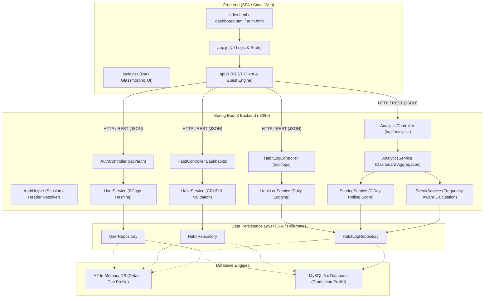

# ⚡ Habify — Daily Activity Tracker & Discipline Analytics

[](https://www.oracle.com/java/)
[](https://spring.io/projects/spring-boot)
[](https://hibernate.org/)
[](https://www.mysql.com/)
[](https://developer.mozilla.org/)
[](https://maven.apache.org/)
[](https://junit.org/junit5/)

> **Build unshakeable habits, maintain unbroken streaks, and measure your personal discipline through real-time analytics.**

---

## 📖 Table of Contents

- [Overview](#-overview)
- [Key Features](#-key-features)
- [System Architecture](#-system-architecture)
- [Core Algorithms & Analytics Engine](#-core-algorithms--analytics-engine)
- [Tech Stack](#-tech-stack)
- [Project Structure](#-project-structure)
- [REST API Reference](#-rest-api-reference)
- [Database Configuration & Profiles](#-database-configuration--profiles)
- [Getting Started & Installation](#-getting-started--installation)
- [Testing & Quality Assurance](#-testing--quality-assurance)
- [Screenshots & UI Preview](#-screenshots--ui-preview)
- [Future Roadmap](#-future-roadmap)
- [License & Authors](#-license--authors)

---

## 🌟 Overview

**Habify** is a modern, full-stack personal discipline, daily habit tracking, and productivity analytics platform. Built using **Spring Boot 3 (Java 17)** and a responsive **Vanilla JavaScript / CSS3 Single-Page Interface**, Habify empowers individuals to cultivate positive routines, visualize consistency, and track progress over time.

Habify eliminates the friction of traditional habit apps by providing:
1. **Instant Guest Exploration**: Try the interactive weekly habit board immediately with zero setup.
2. **Frequency-Aware Streaks**: Rest days (e.g., gym on Mon/Wed/Fri) never penalize or break your active streak.
3. **Mathematical Discipline Scoring**: A rolling 7-day weighted completion index reflecting true habit execution.
4. **Interactive Horizontal Weekly Board**: One-click logging and instant visual feedback across the current week.

---

## ✨ Key Features

### 📅 1. Interactive Horizontal Weekly Board
- **Full-Week Grid View**: Visualize all active habits across Monday through Sunday.
- **Single-Click Quick Logging**: Toggle completion statuses (`COMPLETED`, `PARTIAL`, `MISSED`, `SKIPPED`) directly from the grid.
- **Dynamic Weekly Progress Rings**: Live calculation of completion percentages for each habit and each day.

### ⚡ 2. 7-Day Rolling Discipline Score
- **Calculated Metric (0–100%)**: Dynamically measures habit execution across scheduled instances over a rolling 7-day window.
- **Fair Inception Logic**: Habits created mid-week or rest days do not lower your score.
- **Status-Weighted Scoring**: Full credit (100%) for completed habits, proportional credit for partial entries, and 0% for missed tasks.

### 🔥 3. Frequency-Aware Streak Tracking
- **Smart Rest-Day Tolerance**: Custom routines (e.g., Weekdays only, Weekends only, or Mon/Wed/Fri) preserve streaks on non-scheduled rest days.
- **Ongoing & Historic Records**: Tracks both the **Current Active Streak** and the **Longest Ever Streak** for every habit.
- **Pending Day Grace Period**: Today's active streak remains intact until the day closes or is logged as missed.

### 🎯 4. Flexible Habit Customization & Lifecycle
- **Custom Scheduling**: Supports `DAILY`, `WEEKDAYS`, `WEEKENDS`, and custom days (`MONDAY,WEDNESDAY,FRIDAY`).
- **Rich Metadata**: Categorize habits (`Coding`, `Fitness`, `Health`, `Study`, `Reading`, `Productivity`), set priorities (`HIGH`, `MEDIUM`, `LOW`), target values (e.g., `2 hours`, `25 pages`), and preferred times (`MORNING`, `AFTERNOON`, `EVENING`, `ANYTIME`).
- **Archive / Toggle Active**: Pause or resume habits without losing historic completion logs.

### 🔐 5. Dual Storage Engine & Frictionless Auth
- **Guest Mode (Local Engine)**: Instant client-side testing backed by browser `localStorage` with preloaded starter habits.
- **Secure Cloud Mode**: Full user accounts secured with **BCrypt password hashing**, multi-tenancy isolation (`user_id`), and RESTful token authentication (`X-User-Id` / Bearer token).

### 📊 6. Analytics & Performance Dashboard
- **Live Summary KPI Strip**: Real-time stats on Total Habits, Today's Completion Rate, Discipline Score, and Max Streak.
- **Weekly Trend Bar Breakdown**: Daily execution breakdown with scheduled vs. completed volume.
- **Category Distribution**: Visual insights into how time and discipline are allocated across life areas.

---

## 🏗 System Architecture

Habify is designed with a clean, layered architecture separating controllers, business logic services, data persistence, and the presentation layer.



---

## 🧮 Core Algorithms & Analytics Engine

### 1. Rolling 7-Day Discipline Score
The **Discipline Score** ($S \in [0, 100]$) measures actual performance against scheduled commitments over a 7-day rolling window $[T-6, T]$:

$$S = \frac{\sum_{d=T-6}^{T} \sum_{h \in H_{\text{active}}} \text{PctEarned}(h, d)}{\sum_{d=T-6}^{T} \sum_{h \in H_{\text{active}}} \mathbb{I}(h \text{ is scheduled on } d)}$$

- **Edge Handling**: If no habits were scheduled in the window or a habit was created recently, past non-existent days do not penalize the score. Baseline defaults to $100\%$.
- **Partial Weighting**: Completed entries earn $100\%$, Partial entries earn logged $\%$ (default $50\%$), and unlogged or missed days earn $0\%$.

### 2. Frequency-Aware Streak Calculation
- Habits define scheduled days $D_{\text{sched}} \subseteq \{\text{MON}, \text{TUE}, \dots, \text{SUN}\}$.
- When traversing backwards in time:
  - If date $d \in D_{\text{sched}}$ and $\text{Log}(h, d)$ is successful ($\ge 50\%$), $\text{Streak} \leftarrow \text{Streak} + 1$.
  - If date $d \in D_{\text{sched}}$ and $\text{Log}(h, d)$ is missed or absent in the past, the streak terminates.
  - If date $d \notin D_{\text{sched}}$, date $d$ is **skipped** without breaking the active streak.
  - Traverse backwards only up to $\max(\text{CreatedAt}(h), T - 365)$.

---

## 💻 Tech Stack

| Domain | Technology | Version | Purpose |
| :--- | :--- | :--- | :--- |
| **Backend Language** | Java | 17+ (LTS) | Core application programming language |
| **Backend Framework**| Spring Boot | 3.3.3 | REST API, IOC container, auto-configuration |
| **ORM & Persistence**| Spring Data JPA / Hibernate | 6.5.2 | Entity mapping, queries, transactions |
| **Validation** | Jakarta Bean Validation (JSR-380) | Standard | Request payload validation (`@NotBlank`, `@Min`, etc.) |
| **Security / Crypto**| Spring Security Crypto | Standard | BCrypt hashing for user credentials |
| **Embedded DB** | H2 Database Engine | In-Memory | Zero-setup instant development and testing |
| **Relational DB** | MySQL Connector/J | 8.x | Production relational database storage |
| **Frontend UI** | HTML5 / CSS3 / ES6 JavaScript | Native | Responsive Single-Page Application (No external framework overhead) |
| **Typography** | Inter & Plus Jakarta Sans | Google Fonts | High-readability modern typography |
| **Build & Tooling** | Apache Maven & Maven Wrapper | 3.x | Dependency management, build lifecycle, and packaging |
| **Testing** | JUnit 5, Mockito, AssertJ | Latest | Unit testing, repository mocks, and integration tests |

---

## 📂 Project Structure

```
Habify - Daily Activity Tracker/
├── pom.xml                               # Maven project configuration & dependencies
├── mvnw.cmd                              # Maven Wrapper for Windows
├── README.md                             # Comprehensive project documentation
├── src/
│   ├── main/
│   │   ├── java/com/habify/
│   │   │   ├── HabifyApplication.java    # Spring Boot Main Entry Point
│   │   │   ├── config/
│   │   │   │   └── AuthHelper.java       # User resolution & Bearer/Header parser
│   │   │   ├── controller/
│   │   │   │   ├── AnalyticsController.java # Dashboard KPIs & Streak endpoints
│   │   │   │   ├── AuthController.java      # Register, Login & Profile API
│   │   │   │   ├── HabitController.java     # Habit CRUD & toggle operations
│   │   │   │   └── HabitLogController.java  # Daily logging & range query API
│   │   │   ├── dto/
│   │   │   │   ├── AuthResponse.java
│   │   │   │   ├── DailyProgressDTO.java
│   │   │   │   ├── DashboardSummaryResponse.java
│   │   │   │   ├── HabitLogRequest.java
│   │   │   │   ├── HabitLogResponse.java
│   │   │   │   ├── HabitRequest.java
│   │   │   │   ├── HabitResponse.java
│   │   │   │   ├── LoginRequest.java
│   │   │   │   ├── RegisterRequest.java
│   │   │   │   ├── StreakDTO.java
│   │   │   │   ├── TodayHabitDTO.java
│   │   │   │   └── UserProfileResponse.java
│   │   │   ├── entity/
│   │   │   │   ├── FrequencyType.java    # DAILY, WEEKDAYS, WEEKENDS, CUSTOM
│   │   │   │   ├── Habit.java            # Habit entity with schedule rules
│   │   │   │   ├── HabitLog.java         # Activity log entity with unique constraint
│   │   │   │   ├── HabitStatus.java      # COMPLETED, PARTIAL, MISSED, SKIPPED
│   │   │   │   ├── Priority.java         # HIGH, MEDIUM, LOW
│   │   │   │   ├── TimeOfDay.java        # MORNING, AFTERNOON, EVENING, ANYTIME
│   │   │   │   └── User.java             # User entity with BCrypt password hash
│   │   │   ├── exception/
│   │   │   │   ├── BadRequestException.java
│   │   │   │   ├── GlobalExceptionHandler.java
│   │   │   │   ├── ResourceNotFoundException.java
│   │   │   │   └── UnauthorizedException.java
│   │   │   ├── repository/
│   │   │   │   ├── HabitLogRepository.java
│   │   │   │   ├── HabitRepository.java
│   │   │   │   └── UserRepository.java
│   │   │   └── service/
│   │   │       ├── AnalyticsService.java
│   │   │       ├── HabitLogService.java
│   │   │       ├── HabitService.java
│   │   │       ├── ScoringService.java
│   │   │       ├── StreakService.java
│   │   │       └── UserService.java
│   │   └── resources/
│   │       ├── application.properties        # Default configuration (H2 In-Memory)
│   │       ├── application-mysql.properties  # Production MySQL configuration
│   │       ├── schema-mysql.sql              # Standalone MySQL schema definitions
│   │       └── static/
│   │           ├── index.html                # Main Horizontal Weekly Board
│   │           ├── dashboard.html            # Analytics & Habit Workspace
│   │           ├── auth.html                 # Sign In / Sign Up Screen
│   │           ├── css/
│   │           │   └── style.css             # Glassmorphic dark design system
│   │           └── js/
│   │               ├── api.js                # API Client, Session & Guest Engine
│   │               └── app.js                # UI Controller, Charts & Modals
│   └── test/
│       └── java/com/habify/
│           ├── HabifyApplicationTests.java   # Spring Context Bootstrapping Test
│           └── service/
│               ├── HabitLogServiceTest.java
│               ├── HabitServiceTest.java
│               ├── ScoringServiceTest.java
│               ├── StreakServiceTest.java
│               └── UserServiceTest.java
```

---

## 📡 REST API Reference

All requests to protected endpoints require authentication via either:
- **Header**: `X-User-Id: <userId>`
- **Authorization Header**: `Authorization: Bearer hbf_<userId>_<token>`

### 1. Authentication Endpoints (`/api/auth`)

| Method | Endpoint | Request Body | Description |
| :--- | :--- | :--- | :--- |
| `POST` | `/api/auth/register` | `{ fullName, email, username, password }` | Registers a new account and returns auth token |
| `POST` | `/api/auth/login` | `{ identifier, password }` | Authenticates with email/username and returns user session |
| `GET` | `/api/auth/profile` | *None* (Protected) | Fetches the authenticated user profile & metadata |

### 2. Habit Management Endpoints (`/api/habits`)

| Method | Endpoint | Request Body | Description |
| :--- | :--- | :--- | :--- |
| `GET` | `/api/habits` | *None* | Retrieves all habits belonging to the current user |
| `POST` | `/api/habits` | `HabitRequest` | Creates a new habit with custom frequency & targets |
| `GET` | `/api/habits/{id}` | *None* | Retrieves details for a specific habit |
| `PUT` | `/api/habits/{id}` | `HabitRequest` | Updates title, frequency, targets, or schedule |
| `PATCH`| `/api/habits/{id}/toggle-active` | *None* | Activates or pauses a habit |
| `DELETE`| `/api/habits/{id}` | *None* | Deletes a habit and associated logs |

### 3. Habit Activity Logs Endpoints (`/api`)

| Method | Endpoint | Request Body / Params | Description |
| :--- | :--- | :--- | :--- |
| `POST` | `/api/habits/{habitId}/logs` | `{ logDate, status, completionPercentage, note }` | Logs or updates completion status for a date |
| `GET` | `/api/habits/{habitId}/logs` | *None* | Retrieves all history logs for a habit |
| `GET` | `/api/logs/today` | *None* | Retrieves today's scheduled habits with log statuses |
| `GET` | `/api/logs/range` | `?startDate=YYYY-MM-DD&endDate=YYYY-MM-DD` | Retrieves all logs within a specified date window |

### 4. Analytics & Consistency Endpoints (`/api/analytics`)

| Method | Endpoint | Description |
| :--- | :--- | :--- |
| `GET` | `/api/analytics/dashboard` | Returns Discipline Score, Active Habits count, Today's Completion %, Longest Streak, and 7-day progress |
| `GET` | `/api/analytics/habits/{habitId}/streak` | Returns Current Streak, Longest Streak, and Total Completed Days |

---

## ⚙️ Database Configuration & Profiles

Habify supports dual persistence modes out of the box:

### 1. Default Profile: In-Memory H2 Database
- Zero installation required; ideal for evaluation, grading, and rapid testing.
- **H2 Console URL**: [http://localhost:8080/h2-console](http://localhost:8080/h2-console)
- **JDBC URL**: `jdbc:h2:mem:habifydb`
- **Username**: `sa`
- **Password**: *(leave blank)*

### 2. Production Profile: MySQL Database
To run with a persistent MySQL database:
1. Create a MySQL database or let Habify create it automatically:
   ```sql
   CREATE DATABASE IF NOT EXISTS habify_db CHARACTER SET utf8mb4 COLLATE utf8mb4_unicode_ci;
   ```
2. Configure credentials in [application-mysql.properties](file:///d:/PBL/Habify%20-%20Daily%20Activity%20Tracker/src/main/resources/application-mysql.properties):
   ```properties
   spring.datasource.url=jdbc:mysql://localhost:3306/habify_db?createDatabaseIfNotExist=true&useSSL=false&allowPublicKeyRetrieval=true&serverTimezone=UTC
   spring.datasource.username=root
   spring.datasource.password=your_password
   ```
3. Launch with the MySQL profile:
   ```powershell
   .\mvnw.cmd spring-boot:run -Dspring-boot.run.profiles=mysql
   ```

---

## 🚀 Getting Started & Installation

### Prerequisites
- **JDK 17 or higher** installed and available on your `PATH`.
- Modern web browser (Chrome, Edge, Firefox, Safari).

### Quick Start (Windows / PowerShell)

1. **Clone or Navigate to the Project Directory**:
   ```powershell
   cd "d:\PBL\Habify - Daily Activity Tracker"
   ```

2. **Run the Application using Maven Wrapper**:
   ```powershell
   .\mvnw.cmd spring-boot:run
   ```

3. **Access the Web Workspace**:
   Open your browser and navigate to:
   - **Horizontal Weekly Board**: [http://localhost:8080/](http://localhost:8080/)
   - **Workspace & Dashboard**: [http://localhost:8080/dashboard.html](http://localhost:8080/dashboard.html)
   - **Sign In / Sign Up**: [http://localhost:8080/auth.html](http://localhost:8080/auth.html)
   - **H2 Database Console**: [http://localhost:8080/h2-console](http://localhost:8080/h2-console)

---

## 🧪 Testing & Quality Assurance

Habify contains unit and integration tests covering the service layer, scoring algorithms, streak evaluation, and user authentication:

To execute the test suite:
```powershell
.\mvnw.cmd test
```

### Test Coverage Highlights:
- **`HabitLogServiceTest`**: Validates logging for scheduled vs. unscheduled days, percentage calculations, and log overrides.
- **`HabitServiceTest`**: Tests habit creation, updates, multi-day scheduling validation, and soft active-state toggles.
- **`ScoringServiceTest`**: Validates the 7-day rolling discipline score mathematical formulation and inception day edge cases.
- **`StreakServiceTest`**: Tests frequency-aware streak calculations, ensuring rest days do not break active chains.
- **`UserServiceTest`**: Validates user registration, duplicate constraint rejections, and BCrypt password authentication.

---

## 🎨 Design Philosophy & UI Features

- **Glassmorphic Dark Theme**: Sleek, high-contrast dark palette tailored with CSS tokens (`#0f172a`, `#1e293b`, `#6366f1`, `#10b981`).
- **Zero Framework Bloat**: Lightweight vanilla JS code ensures sub-50ms page loads and instantaneous UI interactions.
- **Micro-Animations & Feedback**: Smooth hover effects, badge transitions, interactive toast alerts, and modal animations.
- **Responsive Layout**: Designed for desktops, laptops, tablets, and mobile screens.

---

## 🗺 Future Roadmap

- [ ] **Phase 2 - Habit Templates Library**: Pre-configured habit stacks (e.g., *Full-Stack Developer Routine*, *Marathon Training*, *Mindfulness Morning*).
- [ ] **Phase 2 - Export / Import Engine**: Export personal history to JSON / CSV and generate printable weekly summary PDFs.
- [ ] **Phase 2 - AI Habit Coach**: Integration with Gemini API to offer personalized insights and habit adjustment recommendations.
- [ ] **Phase 2 - Social Accountability**: Shareable consistency streaks and peer accountability groups.

---

## 📄 License & Authors

Developed as a **Personal Discipline & Daily Activity Tracking System**.

- **Author**: PBL Development Team
- **Version**: `1.0.0-SNAPSHOT`
- **Framework**: Spring Boot 3.3.3 / Java 17

*⚡ Stay consistent. Build habits. Track progress with Habify.*
